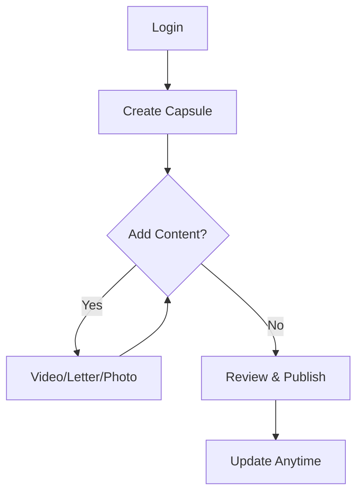

## Overview

Create a lasting time capsule filled with video messages, heartfelt letters, photos, and cherished keepsakes. This space preserves your love and memories securely until your child is ready to discover them. Follow this guide to build and maintain your capsule step by step.

<Callout kind="info">
  You need an active account at [parentsearch.org](https://parentsearch.org/login). Ensure your profile is complete before starting.
</Callout>

<Columns cols={2}>
  <Card title="Record Videos" icon="video" href="#videos">
    Capture spoken memories and advice.
  </Card>
  <Card title="Write Letters" icon="edit-3" href="#letters">
    Pen timeless messages for the future.
  </Card>
  <Card title="Upload Photos" icon="image" href="#photos">
    Add visual memories and milestones.
  </Card>
  <Card title="Organize Content" icon="folder" href="#organize">
    Keep everything structured and easy to update.
  </Card>
</Columns>

## Step-by-Step Building Process

Use these steps to create and populate your time capsule.

<Steps>
  <Step title="Create Your Capsule" icon="plus">
    Log in to your dashboard. Click `New Time Capsule` and enter a name like `Messages for Alex`. Add optional details such as birthdate or themes.
  </Step>
  <Step title="Add Core Content" icon="upload">
    Select `Add Message` from the menu. Choose video, letter, or photo based on your memory.
  </Step>
  <Step title="Review and Save" icon="check-circle">
    Preview your additions. Capsules auto-save, but hit `Publish` to make them discoverable.
  </Step>
</Steps>



## Adding Specific Content Types

Tailor your capsule with these media types.

<Tabs>
  <Tab title="Video Messages" icon="video">
    <Steps>
      <Step title="Record" icon="circle">
        Click `Record Video`. Use your webcam or upload a file (`<5MB`, MP4 format). Speak from the heart about milestones or advice.
      </Step>
      <Step title="Edit & Tag" icon="edit-2">
        Trim clips, add captions, and tag with dates or themes like `birthday` or `advice`.
      </Step>
    </Steps>

    <Callout kind="tip">
      Keep videos under 2 minutes for easy viewing. Test audio levels first.
    </Callout>
  </Tab>
  <Tab title="Letters" icon="edit-3">
    Write timeless notes.

    ```markdown
    Dear [Child's Name],

    On your 10th birthday, I remember...

    Love,
    [Your Name]
    ```

    Save as rich text or PDF. Organize by age or event.
  </Tab>
  <Tab title="Photos & Keepsakes" icon="image">
    Upload high-resolution images (`<10MB`, JPG/PNG).

    <Steps>
      <Step title="Select Files" icon="upload">
        Drag and drop or browse. Add up to 50 per category.
      </Step>
      <Step title="Annotate" icon="tag">
        Describe each item, e.g., `First steps, 2015`.
      </Step>
    </Steps>
  </Tab>
</Tabs>

## Updating and Organizing

Keep your capsule fresh over time.

<Expandable title="Advanced Organization Tips" default-open="true">
  Use folders within capsules for themes like `Holidays` or `Milestones`. Reorder items via drag-and-drop. Set visibility rules, such as `age 18+`.

  | Category     | Best Practices                  |
  |--------------|---------------------------------|
  | Videos      | Annual updates, themed series  |
  | Letters     | Yearly letters, milestone notes|
  | Photos      | Group by year, add context     |
</Expandable>

<Expandable title="Privacy and Security">
  All content is encrypted and private by default. Only accessible via exact name match. Review access logs in settings.
</Expandable>

## Next Steps

<Columns cols={3}>
  <Card title="Share Safely" icon="share-2" href="/guides/sharing">
    Learn secure sharing options.
  </Card>
  <Card title="Manage Access" icon="shield" href="/authentication">
    Control who can view your capsule.
  </Card>
  <Card title="Troubleshooting" icon="help-circle" href="/faq">
    Common issues and solutions.
  </Card>
</Columns>

<Callout kind="success">
  Your time capsule is now ready. Return anytime to add more love.
</Callout>