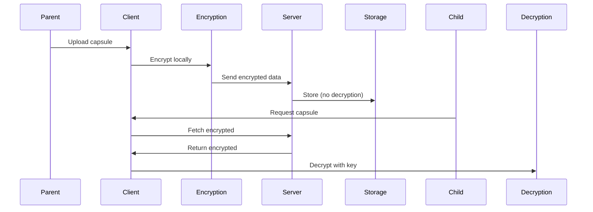

## Overview

Parent Search prioritizes your privacy and safety above all. You control your data, and nothing is shared without your explicit consent. The platform uses end-to-end encryption, strict access controls, and consent-based reconnection to protect separated families.

<Columns cols={2}>
  <Card title="Private by Design" icon="shield" href="#private-by-design">
    Your time capsules remain sealed until the recipient chooses to open them.
  </Card>
  <Card title="Data Protection" icon="lock" href="#data-protection">
    All content is encrypted at rest and in transit.
  </Card>
  <Card title="Access Controls" icon="key" href="#access-controls">
    Multi-layered permissions ensure only authorized access.
  </Card>
  <Card title="Safe Reconnection" icon="heart" href="#safe-reconnection">
    Guided practices for healthy family reunions.
  </Card>
</Columns>

## Private by Design

Your messages, videos, and photos stay completely private. Parent Search does not scan, index, or share your content with third parties. Data exists solely for the intended recipient—your child or parent—when they are ready.

<Callout kind="info">
  No automated searches or AI analysis occur on your time capsules. Privacy is the default setting.
</Callout>

<Tabs>
  <Tab title="Parents" icon="users">
    Create capsules without revealing locations or current details unless you choose to.
  </Tab>
  <Tab title="Children" icon="user">
    Search anonymously; view capsules only after verifying identity through guided consent.
  </Tab>
</Tabs>

## Data Protection and Encryption

Parent Search employs industry-leading encryption. All uploads use AES-256 encryption, with keys managed client-side where possible.

<Expandable title="Encryption Details" default-open="false">
  - **Client-side encryption**: Use your device to encrypt before upload.
  - **TLS 1.3**: All transit secured.
  - **Zero-knowledge storage**: Servers cannot access plaintext.
</Expandable>

## Access Controls and Consent

You define who accesses your data. Multi-factor authentication (MFA) and role-based access ensure security.

<ParamField header="Authorization" param-type="string" required="true">
  Bearer token for API access.
</ParamField>

<ParamField query="consent" param-type="boolean" required="true">
  Explicit user consent flag.
</ParamField>

Only verified recipients with matching search criteria can request access, followed by your approval.

## Safe Reconnection Practices

Follow these steps to ensure emotional safety during reunions.

<Steps>
  <Step title="Prepare Emotionally" icon="heart">
    Reflect on your readiness. Consider professional counseling.
  </Step>
  <Step title="Verify Identity" icon="check-circle">
    Use platform verification tools before sharing contact details.
  </Step>
  <Step title="Start Slow" icon="message-circle">
    Begin with messages, progress to calls only when comfortable.
  </Step>
  <Step title="Set Boundaries" icon="shield">
    Define communication rules upfront.
  </Step>
</Steps>

<Callout kind="tip">
  If issues arise, contact support at support@parentsearch.org or use the in-app reporting.
</Callout>

<Board title="Safety Checklist">
  <BoardColumn title="Complete" color="2" icon="check-circle">
    <BoardCard title="Enable MFA" description="Two-factor authentication active" icon="shield" />
    <BoardCard title="Review Consent" description="All shares approved" icon="key" />
  </BoardColumn>
  <BoardColumn title="In Progress" color="1" icon="loader">
    <BoardCard title="Update Recovery" description="Email and phone verified" icon="settings" dueDate="2024-12-31" />
  </BoardColumn>
  <BoardColumn title="Pending" color="0" icon="circle-dot">
    <BoardCard title="Counseling Prep" description="Schedule session" icon="help-circle" />
  </BoardColumn>
</Board>

Your safety matters. Parent Search provides tools and resources to navigate reunions responsibly.