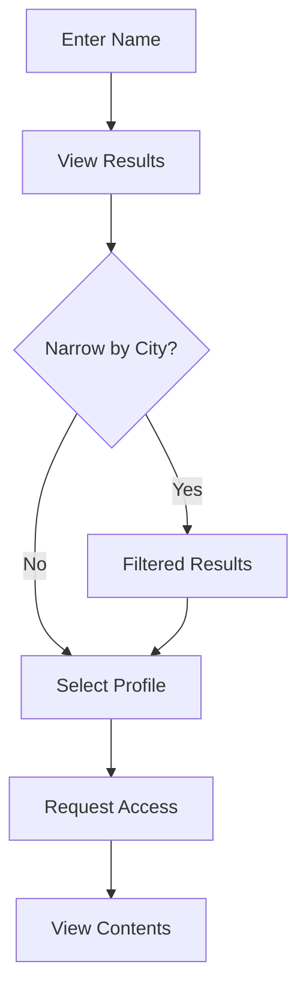

## Overview

Searching for time capsules on Parent Search allows children or family members to find messages, letters, and photos left by parents. Enter a name or partial name to begin, then narrow results by city if needed. Once you locate a capsule, view its contents securely when ready.

<Callout kind="info">
  Searches are private and anonymous. No account is required to search, but you need one to access capsule contents.
</Callout>

## Prerequisites

Before searching:
- Visit [Parent Search](https://parentsearch.org).
- Have the parent's first name, last name (or part), and optionally a city.
- Create an account at [parentsearch.org/join](https://parentsearch.org/join) to claim and view capsules.

## Step-by-Step Search Process

Follow these steps to find a time capsule.

<Steps>
  <Step title="Enter Search Terms" icon="search">
    On the homepage, locate the search bar labeled "Your parent’s name" or "Search".

    Type a full name like `John Smith`, a first name like `John`, or part of a last name like `Smi`.

    Click **Search**.
  </Step>
  <Step title="Review Results" icon="list">
    Scan the list of matching profiles. Each shows name, approximate age, and location hints.

    Results prioritize exact matches first.
  </Step>
  <Step title="Narrow by City" icon="map-pin">
    On the results page, select **Narrow by City**.

    Enter a city like `New York` or `Los Angeles` and apply filters.
  </Step>
</Steps>

## Search Options

Different search approaches suit various scenarios.

<Tabs>
  <Tab title="Exact Name" icon="target">
    Use for known full names.

    Example: `Mary Johnson`

    <Image
      src="https://parentsearch.org/images/search-exact.png"
      alt="Exact name search interface"
      width="600"
      height="400"
    />
  </Tab>
  <Tab title="Partial Name" icon="hash">
    Ideal when you recall only part of the name.

    Example: `Jo` or `Smi`

    Results may include more profiles; use city filter next.
  </Tab>
  <Tab title="Advanced Filters" icon="filter">
    After initial search, filter by:
    - City/State
    - Approximate year of birth

    | Filter       | Example Value     | Purpose                  |
    |--------------|-------------------|--------------------------|
    | City        | New York         | Location-based narrowing |
    | State       | NY               | Broader region           |
    | Birth Year  | 1970s            | Age approximation        |
  </Tab>
</Tabs>

## Viewing Capsule Contents

Once you find a match:

<Steps>
  <Step title="Select Profile" icon="user">
    Click the profile to view summary: capsule creation date and item count.
  </Step>
  <Step title="Request Access" icon="key">
    Log in or create account, then click **View Time Capsule**.

    Parent set access rules (age gate or password optional).
  </Step>
  <Step title="Playback Contents" icon="play-circle">
    Browse sections: Videos, Letters, Photos.

    Play videos directly; download letters/photos.
  </Step>
</Steps>

## Access and Playback Details

Capsules contain multimedia kept private until accessed.

<Columns cols={2}>
  <Card title="Videos" icon="video">
    Recorded messages play in-browser. Supports full-screen and captions.
  </Card>
  <Card title="Letters" icon="file-text">
    Scanned or typed messages. Download as PDF.
  </Card>
  <Card title="Photos" icon="image">
    Keepsakes and family pictures. Zoom and share securely.
  </Card>
  <Card title="Keepsakes" icon="gift">
    Additional mementos like audio notes.
  </Card>
</Columns>

## Troubleshooting

<ExpandableGroup>
  <Expandable title="No Results Found" default-open="true">
    - Try partial names (e.g., `Jo` instead of `John`).
    - Check spelling variations.
    - Contact support via [parentsearch.org/contact](https://parentsearch.org/contact).
  </Expandable>
  <Expandable title="Access Denied">
    Capsule may have age restrictions or require parent approval. Wait or reach out through the platform.
  </Expandable>
</ExpandableGroup>

## Next Steps

<Callout kind="tip">
  After viewing, consider creating your own capsule or sharing your story.
</Callout>

Explore more:

<Columns cols={2}>
  <Card title="Create Capsule" icon="plus" href="https://parentsearch.org/join">
    Build your time capsule today.
  </Card>
  <Card title="How It Works" icon="help-circle" href="https://parentsearch.org/howitworks">
    Full platform overview.
  </Card>
</Columns>